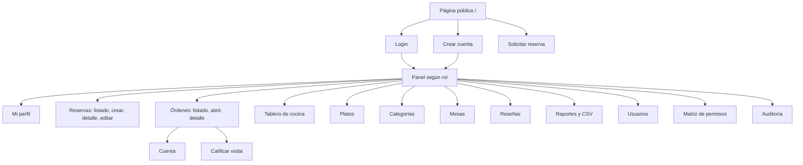

# 01 · Análisis

## Empresa

**El Sazón de la Abuela** es un restaurante de cocina tradicional colombiana (empresa ficticia para este ejercicio) ubicado en la Zona G de Bogotá. Atiende en salón, terraza y un espacio privado, con 12 mesas.

## Problema

Las reservas llegan por WhatsApp y teléfono, sin control de disponibilidad, lo que permite prometer la misma mesa dos veces. Las comandas pasan de palabra entre mesero y cocina, sin saber qué lleva más tiempo esperando. Cobrar y conocer las ventas del día depende de cuentas manuales.

## Objetivos

1. Evitar la doble asignación de mesas con reservas controladas por reglas.
2. Dar trazabilidad a cada orden, desde que se toma hasta que se paga.
3. Mostrarle a cocina una cola ordenada, y al mesero lo que ya puede servir.
4. Ofrecer indicadores y reportes calculados con datos reales.
5. Permitir al cliente reservar y consultar sus consumos.

## Alcance

**Incluye:** sitio público con carta y reservas, cuentas de usuario con cuatro roles, gestión de catálogo y mesas, reservas, órdenes por rondas, tablero de cocina, cuenta con pago simulado, reseñas moderadas, reportes con exportación CSV y auditoría.

**No incluye:** pagos reales, envío de correos o WhatsApp automáticos, inventario de ingredientes, facturación electrónica ni aplicación nativa. Las confirmaciones al cliente se hacen por teléfono; el estado se consulta en su cuenta.

## Actores

| Actor | Objetivo principal |
|---|---|
| Visitante | Conocer la carta y solicitar una reserva sin crear cuenta |
| Cliente | Gestionar sus reservas, consultar consumos y opinar |
| Mesero | Confirmar reservas, tomar órdenes, servir y cobrar |
| Cocina | Preparar comandas en orden e informar platos agotados |
| Administrador | Gestionar el sistema, supervisar la operación y analizar ventas |

## Mapa de navegación

Cada rol ve únicamente las opciones para las que tiene permiso.

## Historias de usuario

| ID | Como | Quiero | Para | Criterio verificable |
|---|---|---|---|---|
| HU-01 | Visitante | ver la carta filtrada por categoría | decidir qué pedir | Solo aparecen platos disponibles de MySQL |
| HU-02 | Visitante | solicitar una reserva sin registrarme | apartar una mesa rápido | Recibo un código; fuera de horario se rechaza |
| HU-03 | Visitante | crear una cuenta | seguir mis reservas | Siempre queda con rol Cliente |
| HU-04 | Cliente | ver y cancelar mis reservas | ajustar mis planes | No veo las ajenas; cancelo hasta 2 h antes |
| HU-05 | Cliente | consultar mis consumos y cuentas | conocer lo que pagué | Solo accedo a mis órdenes |
| HU-06 | Cliente | calificar una visita pagada | compartir mi opinión | Una reseña por orden, publicada tras aprobarse |
| HU-07 | Mesero | confirmar una reserva asignando mesa | organizar el salón | Solo se ofrecen mesas libres y con capacidad |
| HU-08 | Mesero | abrir una orden, también desde una reserva | atender a la mesa | Una sola orden activa por mesa |
| HU-09 | Mesero | agregar platos con notas | informar a cocina | No acepta platos agotados |
| HU-10 | Mesero | saber qué órdenes están listas | servir a tiempo | Aparecen primero en mi panel |
| HU-11 | Mesero | abrir una nueva ronda | atender otro pedido de la mesa | Cocina recibe solo lo nuevo |
| HU-12 | Mesero | cobrar la cuenta | cerrar la orden y liberar la mesa | Total calculado por el servidor; sin doble cobro |
| HU-13 | Cocina | ver comandas por estado y antigüedad | preparar en orden | El tablero se actualiza solo y no muestra precios |
| HU-14 | Cocina | marcar un plato como agotado | que no se siga vendiendo | Sale de la carta al instante |
| HU-15 | Administrador | gestionar usuarios y roles | controlar el acceso | Un usuario desactivado pierde su sesión |
| HU-16 | Administrador | gestionar platos, categorías y mesas | mantener el catálogo | Eliminación lógica; se conserva el histórico |
| HU-17 | Administrador | filtrar y exportar ventas | analizar el negocio | El CSV respeta los filtros y coincide con MySQL |
| HU-18 | Administrador | revisar la auditoría | saber quién hizo qué | Registra acciones críticas, sin secretos |
| HU-19 | Administrador | moderar reseñas | cuidar lo que se publica | Solo las aprobadas cuentan en la página pública |

## Estados

**Reserva:** `pendiente → confirmada → cumplida | no_asistio`; `pendiente | confirmada → cancelada`.

**Orden:** `abierta → enviada → en_preparacion → lista → servida → pagada`; `servida → abierta` (nueva ronda); `abierta | enviada → cancelada`.

## Reglas de negocio

| ID | Regla | Dónde se aplica |
|---|---|---|
| RN-01 | Una mesa no admite dos reservas confirmadas a menos de 2 horas entre sí | `ReservaService`, con bloqueo de fila |
| RN-02 | Reservas dentro del horario, con 1 h de anticipación y hasta 60 días | `ReservaService` |
| RN-03 | La mesa asignada debe tener capacidad para el grupo | `ReservaService` |
| RN-04 | El cliente solo cancela hasta 2 horas antes | `ReservaService` |
| RN-05 | No se aceptan solicitudes duplicadas (correo, fecha y hora) | `ReservaService` |
| RN-06 | Una mesa solo tiene una orden activa y no se abre si se aproxima una reserva ajena | `OrdenService` e índice único en MySQL |
| RN-07 | Una orden vacía no va a cocina; solo se modifica la ronda no enviada | `OrdenService` |
| RN-08 | No se piden platos agotados; el precio se congela al tomarlos | `OrdenService`, `orden_items.precio_unitario` |
| RN-09 | Solo se cobra lo servido y el total se calcula en el servidor | `OrdenService` |
| RN-10 | Solo opina quien consumió, una vez por orden y con moderación | `ResenaController`, índice único |

## Matriz de permisos

La fuente de verdad es la tabla `rol_permisos`, visible en el sistema en `/permisos`.

| Módulo | Administrador | Mesero | Cocina | Cliente |
|---|---|---|---|---|
| Usuarios | ver, crear, editar, aprobar, eliminar | — | — | — |
| Categorías | ver, crear, editar, aprobar, eliminar | — | — | — |
| Platos | ver, crear, editar, aprobar, eliminar | ver | ver, aprobar (agotado) | — |
| Mesas | ver, crear, editar, aprobar, eliminar | ver | — | — |
| Reservas | ver, crear, editar, aprobar, eliminar | ver, crear, editar, aprobar, eliminar | — | ver, crear, editar, eliminar (solo propias) |
| Órdenes | ver, crear, editar, aprobar, eliminar | ver, crear, editar, eliminar (solo propias) | — | ver (solo propias) |
| Cocina | ver, crear, editar, aprobar, eliminar | — | ver, aprobar | — |
| Cuentas | ver, crear, editar, aprobar, eliminar | ver, crear (solo propias) | — | ver (solo propias) |
| Reseñas | ver, crear, editar, aprobar, eliminar | — | — | ver, crear (solo propias) |
| Reportes | ver | — | — | — |
| Auditoría | ver | — | — | — |
| Permisos | ver | — | — | — |

"Solo propias" se comprueba en los controladores, además del permiso de la ruta.
