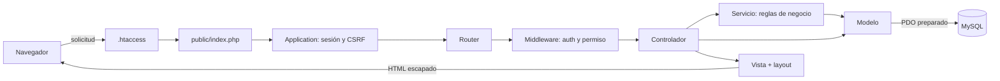
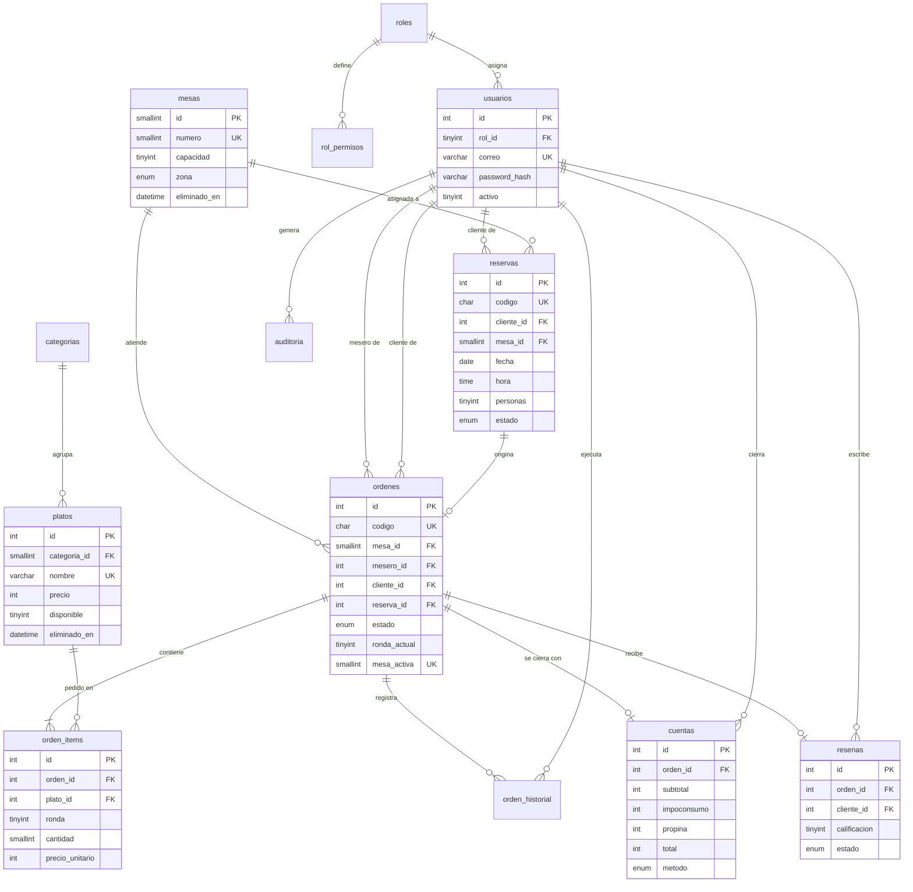
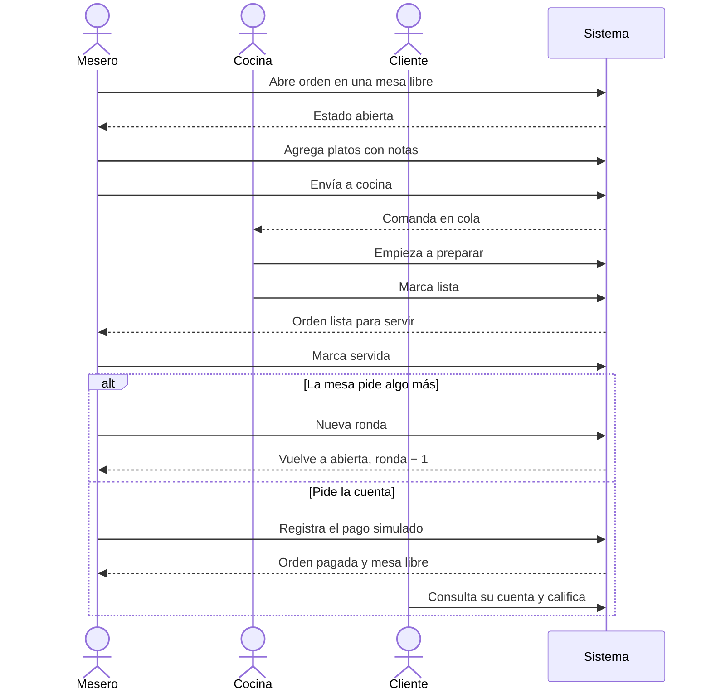
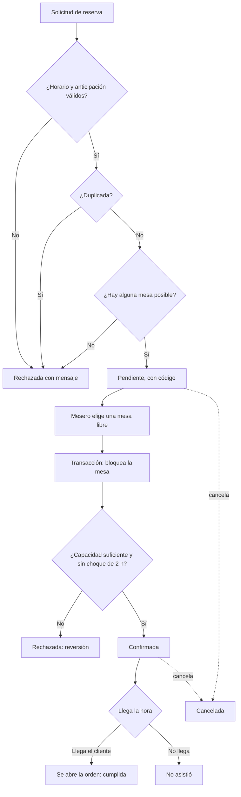

# 02 · Diseño técnico

## Arquitectura MVC

| Capa | Responsabilidad | Ejemplo |
|---|---|---|
| Vista | Solo presentación; no contiene SQL | `app/Views/reservas/show.php` |
| Controlador | Interpreta la solicitud, valida el formato, comprueba la propiedad y elige la respuesta | `ReservaController::confirmar()` |
| Servicio | Reglas de negocio y transacciones | `ReservaService::confirmar()` |
| Modelo | Consultas SQL preparadas | `MesaModel::hayConflicto()` |
| Middleware | Sesión, permiso y CSRF antes del controlador | `PermissionMiddleware` |
| Core | Infraestructura reutilizable | `Router`, `Database`, `Session`, `Validator` |

## Recorrido de una solicitud: confirmar una reserva

Son los puntos que pide la defensa técnica:

| Pieza | Ubicación |
|---|---|
| Ruta | `config/routes.php`: `POST /reservas/{id}/confirmar` con `perm:reservas.aprobar` |
| Sesión | `app/Core/Session.php` |
| Validación CSRF | `app/Middleware/CsrfMiddleware.php` |
| Autorización | `app/Middleware/PermissionMiddleware.php` y `ReservaController::autorizada()` |
| Controlador | `app/Controllers/ReservaController.php`, método `confirmar` |
| Validación de datos | `Controller::validar()` y `app/Core/Validator.php` |
| Regla y transacción | `app/Services/ReservaService.php`, método `confirmar` |
| Conexión PDO | `app/Core/Database.php` |
| Consulta preparada | `app/Models/MesaModel.php`, método `hayConflicto` |
| Vista resultante | `app/Views/reservas/show.php` |

## Modelo entidad-relación

Además, `intentos_login` controla la fuerza bruta. No tiene relaciones: su clave es un hash de correo e IP.

**Decisiones de integridad**

- `ordenes.mesa_activa` es una columna calculada con índice único: MySQL impide dos órdenes activas en una mesa, aunque falle la validación de la aplicación.
- `orden_items.precio_unitario` guarda el precio del momento, por lo que cambiar la carta no altera órdenes anteriores.
- `cuentas.orden_id` y `resenas.orden_id` son únicos: impiden el doble cobro y la doble reseña.
- Platos, mesas y categorías se eliminan de forma lógica (`eliminado_en`), y los usuarios se desactivan, para conservar el histórico.

## Rutas principales

La lista completa está en `config/routes.php`.

| Método y ruta | Controlador | Permiso |
|---|---|---|
| `GET /` | `HomeController@index` | Público |
| `POST /reservas/solicitar` | `ReservaController@solicitar` | Público |
| `GET/POST /login`, `/registro` | `AuthController` | Solo visitantes |
| `POST /logout` | `AuthController@logout` | Sesión |
| `GET /panel` | `PanelController@index` | Sesión |
| `GET /reservas`, `/reservas/{id}` | `ReservaController` | `reservas.ver` + propiedad |
| `POST /reservas/{id}/confirmar` | `ReservaController@confirmar` | `reservas.aprobar` |
| `POST /reservas/{id}/cancelar` | `ReservaController@cancelar` | `reservas.eliminar` + propiedad |
| `GET /ordenes`, `/ordenes/{id}` | `OrdenController` | `ordenes.ver` + propiedad |
| `POST /ordenes/{id}/items` | `OrdenController@agregarItem` | `ordenes.editar` + propiedad |
| `POST /ordenes/{id}/enviar` | `OrdenController@enviar` | `ordenes.editar` + propiedad |
| `GET /cocina`, `/cocina/tablero` | `CocinaController` | `cocina.ver` |
| `POST /cocina/{id}/iniciar`, `/lista` | `CocinaController` | `cocina.aprobar` |
| `POST /ordenes/{id}/cuenta` | `OrdenController@cobrar` | `cuentas.crear` + propiedad |
| `POST /platos/{id}/disponibilidad` | `PlatoController@disponibilidad` | `platos.aprobar` |
| `GET /reportes`, `/reportes/exportar` | `ReporteController` | `reportes.ver` |
| `GET /usuarios`, `/permisos`, `/auditoria` | Respectivos controladores | Solo Administrador |

## Flujo de negocio 1: orden de extremo a extremo

Es el proceso principal (RF-04) y participan tres roles.

## Flujo de negocio 2: reserva y asignación de mesa

## Transacciones

Las operaciones de varias tablas usan `Database::transaction()`: si algo falla, se revierte todo. Los casos críticos además bloquean filas con `SELECT ... FOR UPDATE`, para que dos solicitudes simultáneas se atiendan en fila. La prueba PT-36 lanza dos confirmaciones simultáneas de la misma mesa y comprueba que solo una gana.
